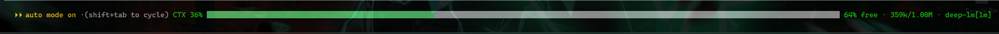

# CTX HUD

A Claude Code mod that puts the context window on the dim line under the
prompt: a bar that fills whatever width the row has, the token counts, the
model, and how many agents are still running.



The bar is not drawn with block characters. It is two boxes that share the row
through the layout, so it fills the line at any width, with a pane docked
beside the prompt or without one, and nothing has to count columns.

## Requirements

Claude Code with the mod API and the `PromptHint` render site. Built and run
on **2.1.312**; the earliest build that carries both has not been established,
so that is the version this is known to work on rather than a floor.

## Install

The repository is its own marketplace:

```bash
claude plugin marketplace add Coverup20/claude-code-ctx-hud
claude plugin install ctx-hud@claude-code-ctx-hud
```

Or, inside a session:

```text
/plugin install ctx-hud --marketplace Coverup20/claude-code-ctx-hud
```

The mod loads at the start of a session, and reloads on its own whenever its
files change.

## The row it draws in

The reading goes in `PromptHint`, the dim line under the prompt where the
engine writes `esc to interrupt` and `? for shortcuts`.

That row is never handed back. An earlier version yielded it while a turn was
running, on the assumption that the engine would use it, and the row simply
went blank. So whatever the engine would have said there is read from the
`hint` prop and drawn here instead, dim, beside the reading. Nothing is lost
and the row is never empty.

A consequence worth knowing: rewriting that line gives up any live pills the
engine would have drawn in it. The alternative, `tail`, adds text after the
engine's own line without replacing it, but it is text only and could not
carry the bar.

## What it reads

- The context figures the engine pushes at `session.measure` — the same ones
  the built-in status line uses. No API request, no tokens spent.
- `$.session.model()`, the main loop's model as `/model` shows it.
- From `$.agent.list()`, only how many agents have not ended. No id, no name,
  no description leaves that count.

## What it does not read

The module hooks four events: `session.measure`, `agent.spawn`,
`turn.complete`, and `ui.render` for `PromptHint`. It does not hook
`prompt.submit`, `tool.call` or `session.append`, and never calls
`$.session.messages()`. It therefore has no access to prompt text, tool
arguments, tool output or model replies.

It calls neither `$.fs`, `$.http` nor `$.process`: it writes no file, opens no
socket, starts no command. There is no telemetry and no persistent log.
`claude plugin validate` prints every hook and engine call the module makes,
which is how to hold this section to the source.

## Colours

Two constants at the top of `hooks/register.tsx`, both theme keys rather than
fixed colours, so a theme change carries the bar with it:

```tsx
const BAR_FILLED = 'success'
const BAR_TROUGH = 'inactive'
```

## State

One value, `ctx-hud.hud`, declared in `types/index.d.ts` and tagged
`shape: 'hud-2'`. Five fields: the fill, the tokens, the window, the model
name and the agent count. It lives in session state only, and a value an
older shape wrote is dropped rather than read back wrong.

## Checks

```bash
claude plugin validate .   # manifest, hooks, engine calls, state contract
claude plugin test .       # the *.test.tsx files
```

The tests mount the tree and read it back; they do not lay it out, so the
widths the layout produces are not covered by them.

## Uninstall

```bash
claude plugin uninstall ctx-hud@claude-code-ctx-hud
```

Nothing else is touched: the mod writes no settings, adds no hook to
`settings.json` and leaves no file outside its own folder.

## License

[MIT](LICENSE)
